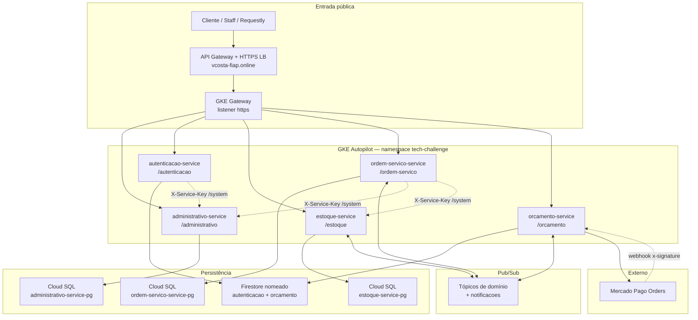
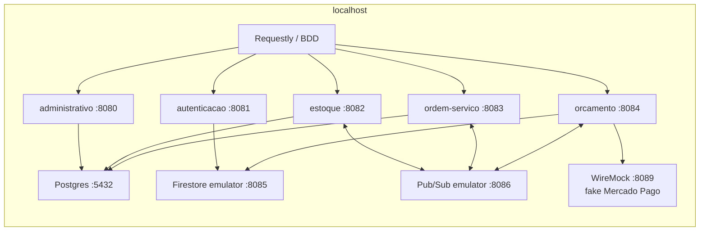

# Arquitetura do sistema

Visão dos componentes da oficina na GCP e no compose local. Contratos: [HTTP](contratos-http.md), [eventos](eventos.md). Sequências e estados da Saga: [saga.md](saga.md). Domínio: [dominio/](dominio/). ADRs: [adrs/](adrs/).

## Componentes (GCP)

Rotas `/system/{servico}/…` não passam pelo Gateway público: só DNS interno do cluster (ou nome do container no compose).

## Componentes (compose local)

## Saga

Coreografia entre `ordem-servico-service`, `orcamento-service` e `estoque-service` (sem orquestrador). Diagrama de estados, caminho feliz e compensações estão em [saga.md](saga.md).
