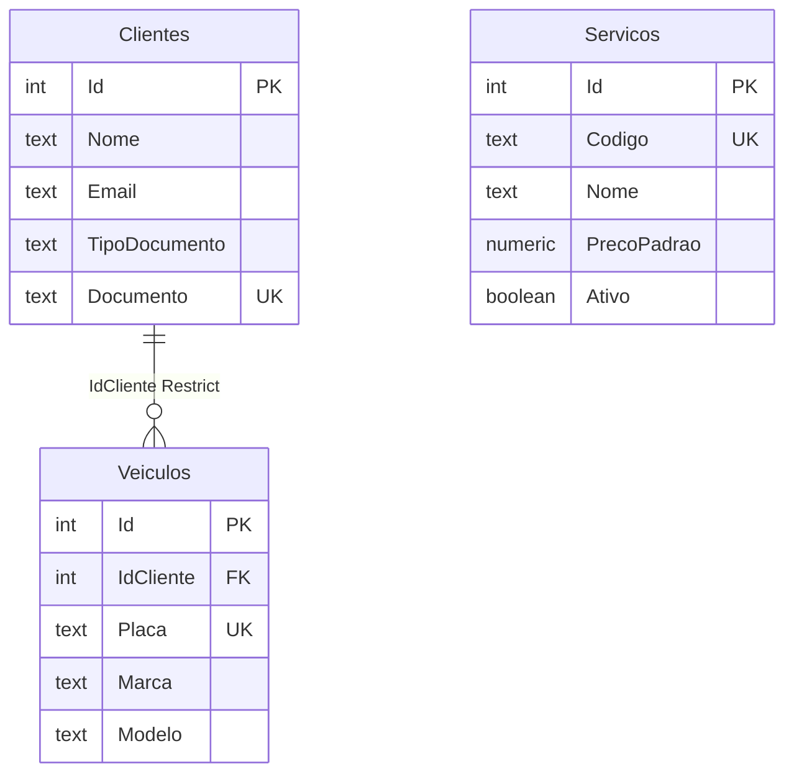

# Domínio — `administrativo-service`

PostgreSQL na instância `administrativo-service-pg`. Catálogo e cadastros consumidos pela OS via REST `/system/administrativo/…`.

## Linguagem onipresente

* **Cliente:** pessoa física ou jurídica atendida pela oficina (`Cpf` / `Cnpj`, documento normalizado e único).
* **Veículo:** automóvel do cliente, identificado pela **placa** (formato antigo ou Mercosul).
* **Serviço (catálogo):** mão de obra tabelada (`Codigo`, nome, preço padrão, ativo/inativo), usada como base do item de serviço na OS.
* **Documento:** VO de CPF/CNPJ com validação de dígitos.

Este serviço **não** publica eventos Pub/Sub.

## Modelo de dados

`Servicos` é catálogo independente (sem FK para OS). A OS copia os dados no snapshot na abertura/diagnóstico.
