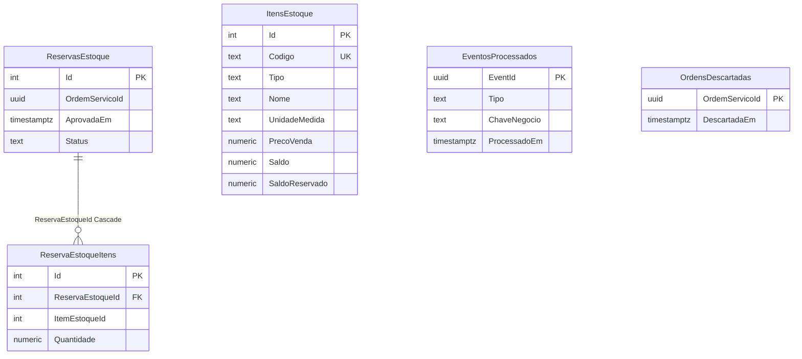

# Domínio — `estoque-service`

PostgreSQL na instância `estoque-service-pg`. Reserva com `SELECT … FOR UPDATE`; fila de pendências pela ordem de aprovação da OS.

## Linguagem onipresente

* **Item de estoque:** peça ou insumo (`Peca` / `Insumo`) com código, unidade de medida, preço de venda, `Saldo` e `SaldoReservado`. **Saldo disponível** = saldo − reservado.
* **Entrada:** aumenta o saldo físico e pode destravar pendências.
* **Reserva:** trava quantidade para uma OS aprovada (`OrdemServicoId` + `AprovadaEm`).
* **Pendência:** reserva em status `Pendente` quando não há saldo; reavaliada na entrada (prioridade = ordem de `AprovadaEm`).
* **Consumo:** após `OrdemServicoFinalizada`, reserva `Consumida`.
* **Liberação:** após `OrdemServicoDescartada`, devolve saldo reservado (`Liberada`).

Publica `EstoqueReservado` / `EstoqueEmFalta`. Consome aprovação, finalização e descarte da OS.

## Modelo de dados

`Status` da reserva: `Pendente` | `Reservada` | `Consumida` | `Liberada`. Índice único `(OrdemServicoId, AprovadaEm)`.
