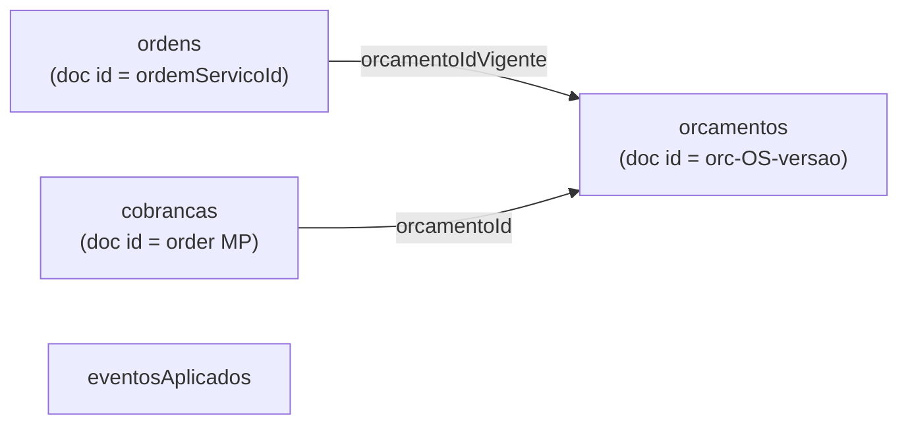

# Domínio — `orcamento-service`

Firestore database nomeado `orcamento` ([ADR 002](../adrs/002-firestore-databases-nomeados.md)). Cobrança via Mercado Pago Orders (Pix).

## Linguagem onipresente

* **Orçamento:** total dos serviços não rejeitados de um diagnóstico (`versaoDiagnostico`); status `Ativo` / `Cancelado`.
* **Cobrança:** order Pix no Mercado Pago; `cobrancaId` = id da order; QR/ticket para o cliente.
* **Ordem (visão local):** documento por `ordemServicoId` com orçamento vigente e flag de descarte.
* **Expiração:** cobrança `Expirada` sem retry automático; staff pode gerar nova cobrança.
* **Recusa:** cancela e **recria** cobrança automaticamente (OS permanece em `AguardandoPagamento`).
* **Notificações:** `OrcamentoDisponivel` / `CobrancaPixDisponivel` no tópico `notificacoes` (sem consumidor de e-mail).

## Modelo de dados (coleções)

| Coleção | Campos principais |
|---------|-------------------|
| `orcamentos` | `ordemServicoId`, `versaoDiagnostico`, `cliente`, `servicos[]`, `valorTotal`, `status`, `criadoEm` |
| `ordens` | `ordemServicoId`, `versaoVigente`, `orcamentoIdVigente`, `descartada` |
| `cobrancas` | `id`, `ordemServicoId`, `orcamentoId`, `idempotencyKey`, `valorTotal`, `qrCode`, `ticket`, `status`, `criadaEm` |
| `eventosAplicados` | `eventId`, `tipo`, `chaveNegocio`, `processadoEm` |

Status de cobrança: `Pendente` | `Confirmada` | `Recusada` | `Expirada` | `Cancelada`.
