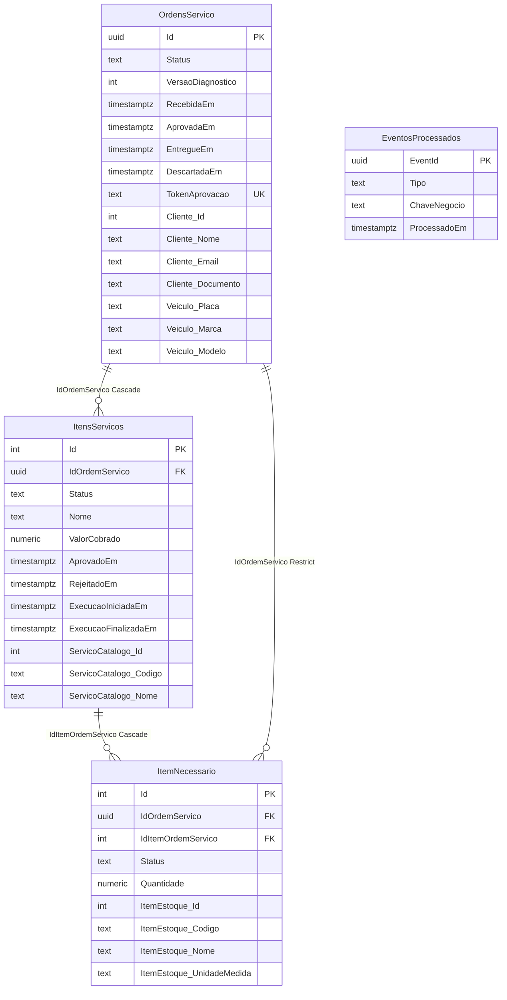

# Domínio — `ordem-servico-service`

PostgreSQL na instância `ordem-servico-service-pg`. Fonte de mapeamento: `AppDbContext` do serviço. Ciclo de vida e Saga: [saga.md](../saga.md).

## Linguagem onipresente

* **Ordem de Serviço (OS):** agregado que centraliza o atendimento. Guarda **snapshot** de cliente e veículo; itens de serviço e itens necessários.
* **Cliente (snapshot):** nome, e-mail e documento copiados do administrativo na abertura.
* **Veículo (snapshot):** placa, marca e modelo copiados na abertura.
* **Item de serviço:** linha de mão de obra na OS (`Sugerido`, `Aprovado`, `Rejeitado`, `Concluido`), com snapshot do catálogo.
* **Item necessário:** peça/insumo ligado a um item de serviço; status de estoque na visão da OS (`EstoqueNaoChecado` … `Utilizado`), com snapshot do item de estoque.
* **Token de aprovação:** valor opaco para o cliente aprovar/rejeitar com JWT.
* **Versão de diagnóstico:** incrementa a cada finalização; amarra `DiagnosticoFinalizado` / orçamento.
* **Notificação:** publicada em tópico Pub/Sub (`notificacoes`); **sem** envio SMTP neste sistema.

### Status da OS

`Recebida` → `EmDiagnostico` → `AguardandoOrcamento` → (`AguardandoAprovacao` | `ChecandoEstoque` | `Entregue`) → … → `Finalizada` → `AguardandoPagamento` → (`Entregue` | `CobrancaExpirada`). Também: `AguardandoPeca`, `LiberadaParaExecucao`, `EmExecucao`, `Descartada`. Detalhe e listagem: [saga.md](../saga.md).

## Modelo de dados

Colunas `Cliente_*`, `Veiculo_*`, `ServicoCatalogo_*` e `ItemEstoque_*` são **snapshots** (não FK para outros serviços). `OrdemServicoId` nos eventos Pub/Sub é o mesmo `Guid` da OS.
