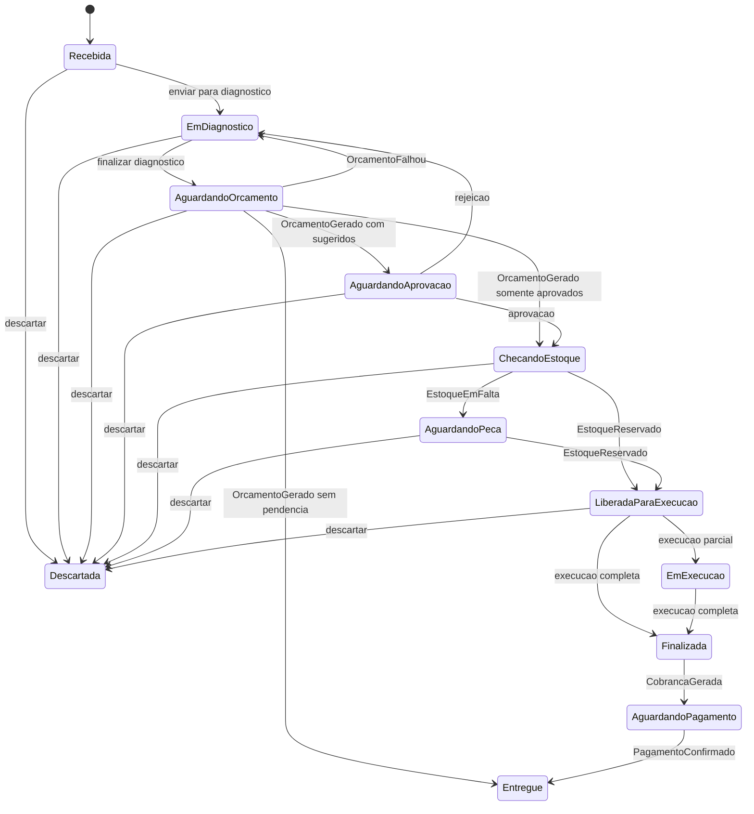
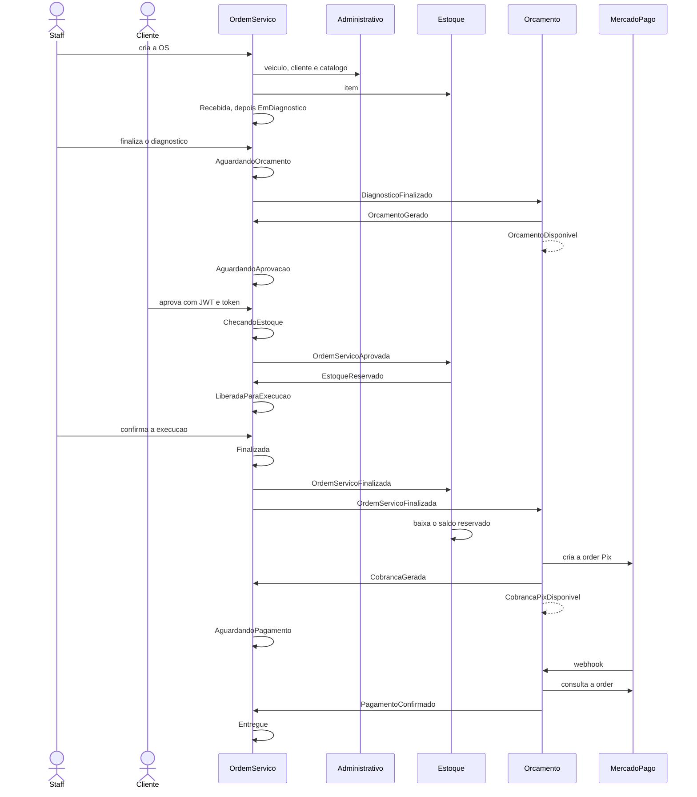
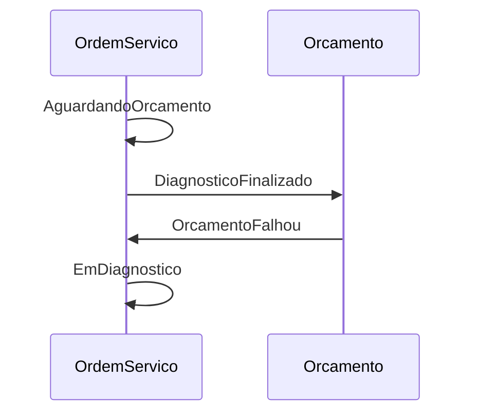
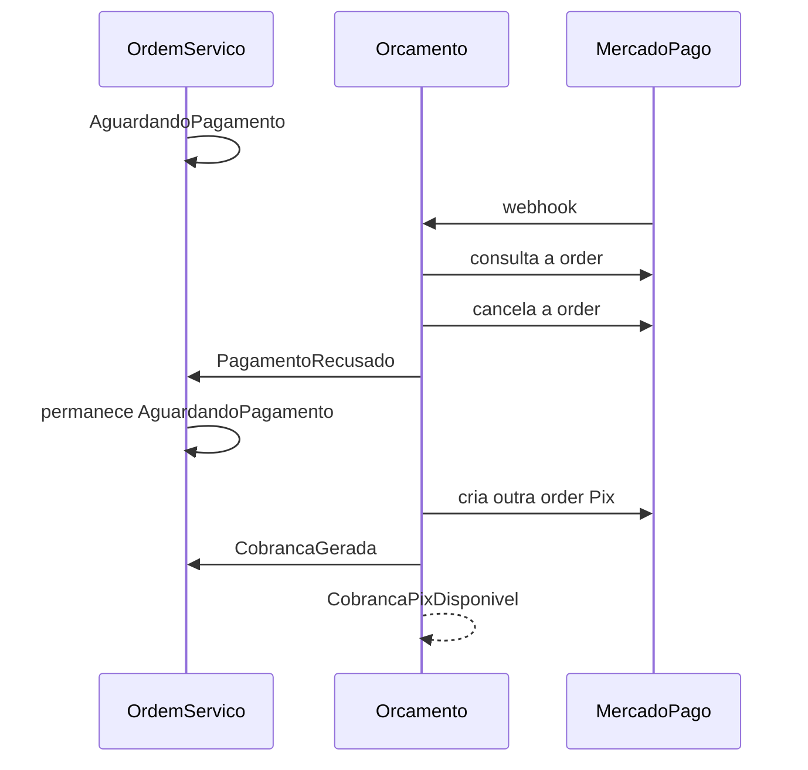
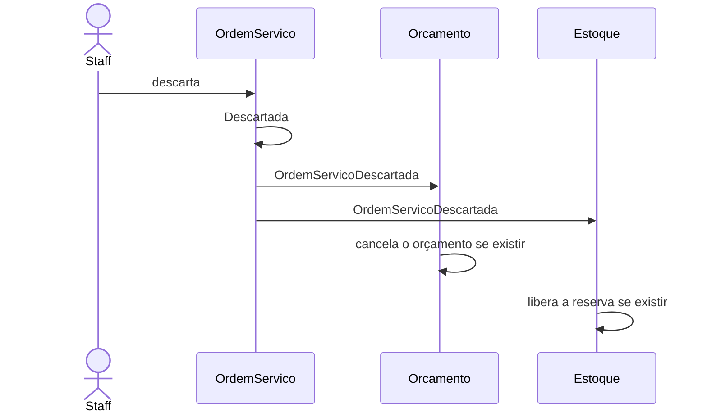
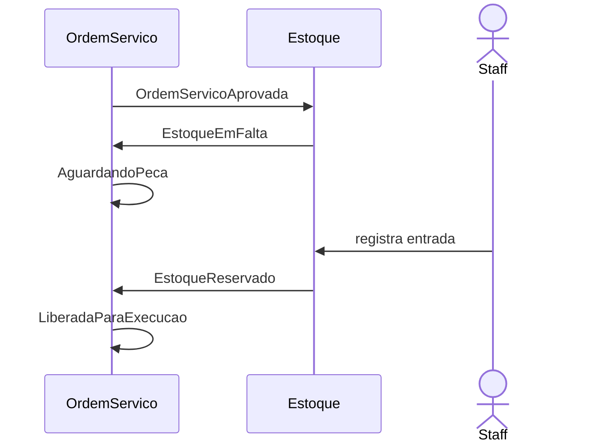

# Saga da ordem de serviço

Coreografia entre `ordem-servico-service`, `orcamento-service` e `estoque-service`. Não há orquestrador. Os nomes, tópicos e payloads estão em [eventos.md](eventos.md).

## Enum e listagem

A declaração abaixo é a ordem do enum. A listagem ordena pelo valor do enum, do maior para o menor, e exclui `Finalizada`, `AguardandoPagamento`, `Descartada` e `Entregue`. Com isso `AguardandoOrcamento` aparece logo acima de `EmDiagnostico`. Dentro do mesmo status, a mais antiga (`recebidaEm`) vem primeiro.

Prioridade da listagem, da mais alta para a mais baixa: `EmExecucao`, `LiberadaParaExecucao`, `AguardandoPeca`, `ChecandoEstoque`, `AguardandoAprovacao`, `AguardandoOrcamento`, `EmDiagnostico`, `Recebida`.

Declaração do enum:

1. `Recebida`
2. `EmDiagnostico`
3. `AguardandoOrcamento`
4. `AguardandoAprovacao`
5. `ChecandoEstoque`
6. `AguardandoPeca`
7. `LiberadaParaExecucao`
8. `EmExecucao`
9. `Finalizada`
10. `AguardandoPagamento`
11. `Descartada`
12. `Entregue`

## Estados

`AguardandoPagamento` permanece nesse status em `PagamentoRecusado` e numa nova `CobrancaGerada`. `EmExecucao` permanece em `EmExecucao` enquanto a confirmação de execução não concluir todos os serviços.

Finalizar o diagnóstico não escolhe mais o destino sozinho. A OS vai para `AguardandoOrcamento` e publica `DiagnosticoFinalizado`. O destino sai quando `OrcamentoGerado` chega:

- há serviço `Sugerido` → `AguardandoAprovacao`
- não há sugerido e há serviço `Aprovado` → `ChecandoEstoque` e `OrdemServicoAprovada`
- não há serviço sugerido nem aprovado → `Entregue`

Rejeição total, ou parcial que ainda deixe sugerido, volta a `EmDiagnostico` e marca os sugeridos restantes como `Rejeitado`. Uma nova finalização incrementa `versaoDiagnostico` e passa de novo pelo orçamento.

Aprovação total, aprovação parcial sem sugeridos restantes, ou o caminho sem sugeridos e com aprovados, grava `aprovadaEm`, coloca a OS em `ChecandoEstoque` e publica `OrdemServicoAprovada`. A OS não compara saldo. `EstoqueReservado` libera a execução. `EstoqueEmFalta` coloca em `AguardandoPeca`. Uma entrada posterior no estoque pode publicar `EstoqueReservado` para essa mesma aprovação e tirar a OS de `AguardandoPeca`. Isso é espera de peça, não compensação.

Descarte é permitido em `Recebida`, `EmDiagnostico`, `AguardandoOrcamento`, `AguardandoAprovacao`, `ChecandoEstoque`, `AguardandoPeca` e `LiberadaParaExecucao`. Não é permitido em `EmExecucao`, `Finalizada`, `AguardandoPagamento` nem `Entregue`.

A execução concluída coloca a OS em `Finalizada` e publica `OrdemServicoFinalizada`. `CobrancaGerada` leva a `AguardandoPagamento`. `PagamentoConfirmado` leva a `Entregue`. `PagamentoRecusado` não muda o status.

## Caminho feliz

A seta tracejada é publicação no tópico `notificacoes`, sem consumidor.

## Compensação: orçamento falha

O staff ajusta o diagnóstico e finaliza de novo. A nova publicação usa outro `versaoDiagnostico`.

## Compensação: pagamento recusado ou expirado

A segunda cobrança tem outro `cobrancaId`. A OS só sai de `AguardandoPagamento` com `PagamentoConfirmado`.

## Compensação: descarte

O descarte vale até `LiberadaParaExecucao`. Quem não tiver orçamento ou reserva só reconhece a mensagem.

## Espera de peça

A fila no estoque atende primeiro a aprovação mais antiga. Enquanto não couber, a OS permanece em `AguardandoPeca`.
